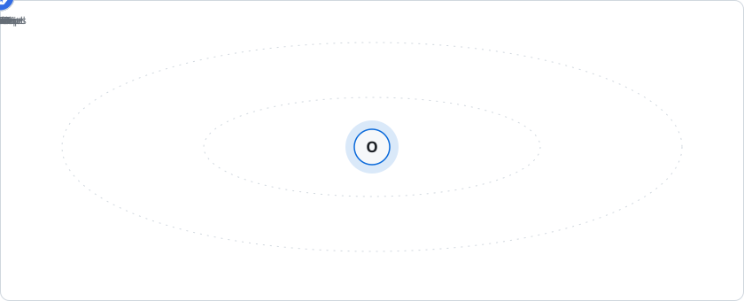

## Hey there! I'm O &nbsp;👋

Engineer by day, coding enthusiast by night. 

---

### Tech Stack

<picture>
  <source media="(prefers-color-scheme: dark)" srcset="./profile/tech-stack-dark.svg" />
  <source media="(prefers-color-scheme: light)" srcset="./profile/tech-stack-light.svg" />
  
</picture>

---

### Stats

<picture>
  <source media="(prefers-color-scheme: dark)" srcset="./profile/overview-dark.svg" />
  <source media="(prefers-color-scheme: light)" srcset="./profile/overview-light.svg" />
  
</picture>

---

### Contributions

<picture>
  <source media="(prefers-color-scheme: dark)" srcset="./profile/github-snake-dark.svg" />
  <source media="(prefers-color-scheme: light)" srcset="./profile/github-snake.svg" />
  
</picture>
